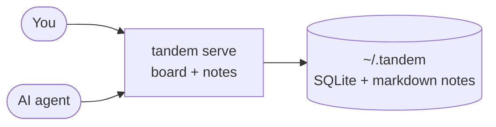

# Tandem

[](https://github.com/gianniacquisto/tandem/actions/workflows/release.yml)
[](https://github.com/gianniacquisto/tandem/releases/latest)
[](LICENSE)


**A board for you and your AI coding agents, in one binary.**

You and your agent share one ticket list: it files tickets you see, and it sees the ones you close. Tickets sit on a board by status and label, with an inbox for what the agents owe you, plus a folder of markdown notes you both read and write. Everything is local: one SQLite database and your own files, with no account and no network.

## Install

```sh
curl -fsSL https://github.com/gianniacquisto/tandem/releases/latest/download/install.sh | sh
```

This verifies a SHA-256 checksum and installs `tandem` (and a `tandem-cli` link) into `~/.local/bin`. Add that to your PATH if the installer says it is missing. Supported: macOS on Apple silicon and Linux on x86_64. On Windows, download the [zip](https://github.com/gianniacquisto/tandem/releases/latest), extract `tandem.exe` and put it on PATH. More options, uninstall and macOS notes: [install paths](docs/install-paths.md).

## Run

```sh
tandem serve --open   # the board, in your browser
tandem serve          # also the MCP endpoint for your agent: POST http://127.0.0.1:7700/mcp
tandem doctor         # check that the install and your data are healthy
```

Your data lives in `~/.tandem`.

## Connect your agent

`tandem serve` is also the MCP server: agents reach it at `POST http://127.0.0.1:7700/mcp`. Start it by hand and leave it running; an agent session has no Tandem tools while it is down. Register the endpoint with your agent host once.

Claude Code (`~/.claude.json`, or a project's `.mcp.json`):

```json
{"mcpServers": {"tandem": {"type": "http", "url": "http://127.0.0.1:7700/mcp", "headers": {"X-Tandem-Agent": "claude"}}}}
```

opencode (`~/.config/opencode/opencode.json`):

```json
{"mcp": {"tandem": {"type": "remote", "url": "http://127.0.0.1:7700/mcp", "headers": {"X-Tandem-Agent": "opencode"}, "oauth": false}}}
```

Any other MCP host: a streamable-HTTP server at that URL.

The `X-Tandem-Agent` header names the agent a write is recorded under (lowercase letters, digits and hyphens). Without it the write is recorded as the server's own actor, which is `human` unless `TANDEM_AGENT` was set when the server started.

### First run

1. Install, then run `tandem serve --open` and leave it running. The board opens, empty.
2. Register the endpoint with your agent host, as above, and start a new agent session.
3. Ask the agent: "file a Tandem ticket called hello".
4. The ticket appears on the board without a reload.
5. Drag it to Done. Ask the agent to list the open tickets: it is gone from the list.

If the agent cannot see the tools, check that `tandem serve` is running and that the port in the config is the one it printed. If the board reports that the store is a schema this build does not read, an older `tandem serve` is still running: see [upgrading](docs/store.md#upgrading). Agent instructions, skills and prompts to copy are in [examples](examples/).

## How it fits together



Details in [architecture](docs/architecture.md).

## Docs

- [Architecture](docs/architecture.md)
- [CLI reference](docs/cli.md)
- [Store, backup and notes](docs/store.md)
- [Glossary](GLOSSARY.md) and [ADRs](docs/adr/README.md), indexed by status
- [Contributing](CONTRIBUTING.md) and [releasing](docs/releasing.md)

## Licence

MIT. See [LICENSE](LICENSE) and [NOTICE.txt](NOTICE.txt).
