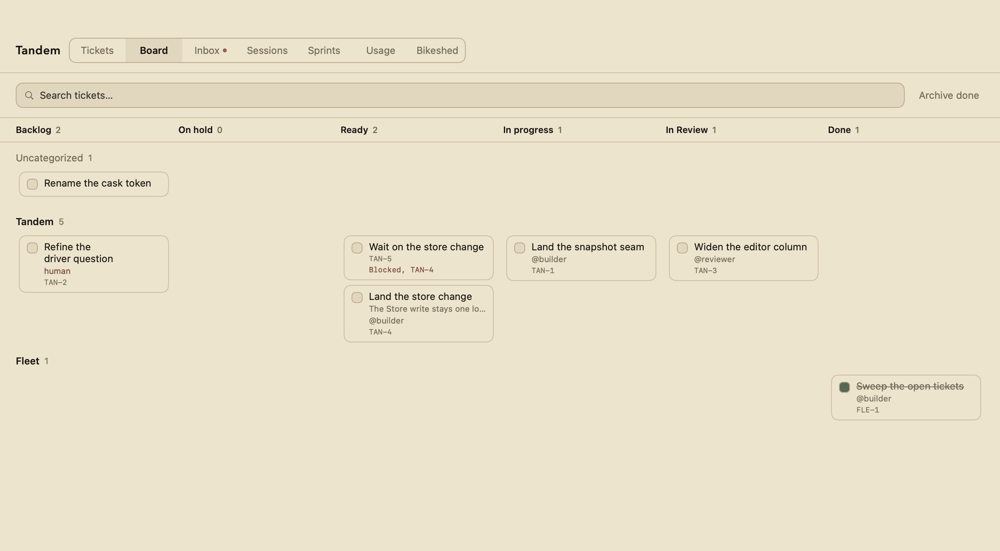
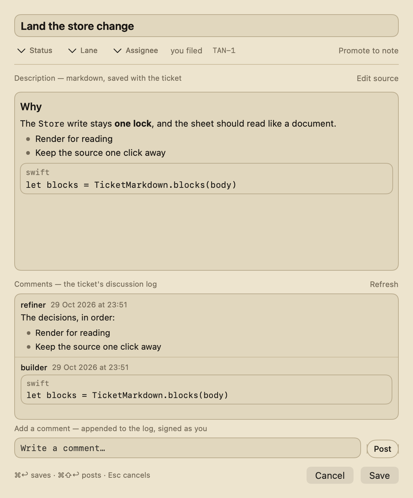
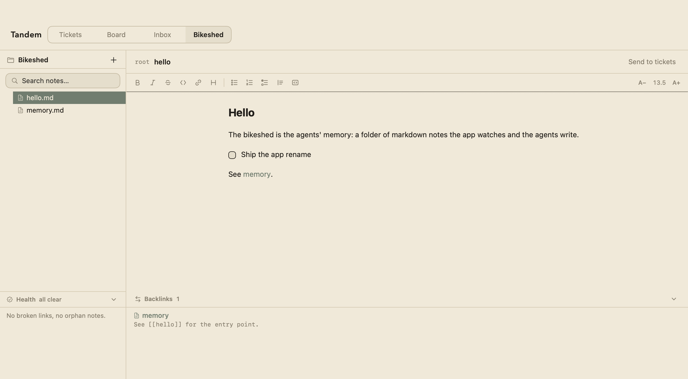

# Tandem

[](https://github.com/gianniacquisto/tandem/actions/workflows/release.yml)
[](https://github.com/gianniacquisto/tandem/releases/latest)
[](https://github.com/gianniacquisto/tandem/releases/latest)
[](LICENSE)


**Tandem is a native macOS board for you and your AI coding agents.** One ticket list, one board by status and lane, an inbox for what the agents owe you, and the bikeshed — a folder of markdown notes — that doubles as the agents' memory. Your agent and you share one list: it files tickets you see, and it sees the ones you close. Everything runs on your Mac, in files you can read. No account, no server, no network.

## Install

macOS 27 (Golden Gate) or later, on an Apple silicon Mac.

```sh
brew install --cask gianniacquisto/tap/tandem
```

Spell the tap out in full, every time. Homebrew core has an unrelated cask named `tandem`, and the Caskroom is keyed by the token — a bare `brew install --cask tandem` installs that one over this app and offers it as an upgrade forever. The install puts `Tandem.app` in `/Applications` and links the bundled `tandem-cli` into Homebrew's `bin`.

### First launch (once per install or upgrade)

Tandem is signed but not notarized by Apple, so macOS shows a Gatekeeper warning the first time you launch it after a download, and the app quits by itself a few seconds later. Clear the download flag once, then relaunch:

```sh
xattr -dr com.apple.quarantine /Applications/Tandem.app
```

Tandem then opens normally until the next install or upgrade.

### Check the install

```sh
tandem-cli doctor
```

One JSON report of where your state lives and whether it is healthy: the home directory, the store, the bikeshed, the comments sidecar, the lock, the installed app and the agent skills. It exits `1` when something needs attention, so it is the quickest way to know a fresh install is whole.

### What it runs on

| | Supported |
| --- | --- |
| macOS | 27 (Golden Gate) or later |
| Hardware | Apple silicon |
| Agent hosts | OpenCode (skills, agent prompts, `AGENTS.md`), Claude Code (skills), and any host that reads skills from a directory |
| Network | none — the app and the CLI are local |
| Accounts | none — the state is files in your home directory |

## What it does

The app and the agent read and write the same store, and the app watches it: a ticket an agent files appears in your window, and a ticket you close is gone from the agent's next read.

| | Since |
| --- | --- |
| The main window and the menu bar item — the same list, two faces | v0.1.0 |
| A ticket list in stored order, grouped by cycle lane, drag to reorder | v0.8.0 |
| Search across every lane, by title and description | v0.10.0 |
| The board — Status columns across, cycle lanes down, a ticket drawn where its Status and lane meet | v0.12.0 |
| The ticket model — Status, Archived, a description, an assignee, a cycle lane | v0.12.0 |
| `in-review`, the sixth Status, and `origin`, who filed a ticket | v0.15.0 |
| The inbox — the tickets the agents assigned to you | v0.12.0 |
| The archive — a fourth state, and the way back | v0.12.0 |
| The ticket sheet — double-click a ticket to edit it whole | v0.12.0 |
| The comment log — a ticket's discussion, appended to and never rewritten | v0.15.0 |
| A comment composer in the ticket sheet, so a human can answer in the app | v0.16.0 |
| Quick open (⌘K) — one ranked list over the notes and the tickets | v0.15.0 |
| An undo toast: one click back from a mis-clicked completion | v0.15.0 |
| The bikeshed — a folder of markdown notes, watched live | v0.6.0 |
| The editor — a CodeMirror page, a formatting toolbar, the folder you choose | v0.10.0 |
| A tree drag that re-parents a note and rewrites the wikilinks that resolve to it | v0.15.0 |
| The health report — broken links, orphan notes | v0.15.0 |
| The hidden layer — the saddlebag of captures, revealed on request | v0.15.0 |
| The note↔ticket bridge — "Send to tickets", "Promote to note" | v0.15.0 |
| The face says tickets — the tab, the search field, the button | v0.16.0 |
| A first-run setup wizard | v0.10.0 |
| The store — one JSON file, watched live, editable by hand | v0.1.0 |
| The rolling backup `todos.json.bak` — the one previous good copy | v0.15.0 |
| The session record — an agent session's own artifact, in `sessions.json` | v0.16.0 |
| A dev build that keeps its own state in `~/.tandem-dev`, so it can never touch yours | v0.9.0 |

Every picture below, and every word of the app's own copy in it, is `dev`'s — the branch the next release is cut from. An installed build can lag `dev` by a release.

The board: the same tickets, laid out by where they are in the workflow.



The ticket sheet: a ticket's title, its Status, its lane, who filed it, the brief, and the discussion under it.



The bikeshed: the notes the app watches and the agents write, with the tree on the left, the note in the editor, and its backlinks below. **Send to tickets** files the selection as a ticket.



## The agent face

### `tandem-cli` on PATH

The cask links the bundled binary into Homebrew's `bin`, so `tandem-cli` is on your PATH after the install. Where the app is installed but the link is not:

```sh
ln -s "/Applications/Tandem.app/Contents/MacOS/tandem-cli" "$(brew --prefix)/bin/tandem-cli"
```

Every command prints JSON on stdout.

```sh
tandem-cli ticket list [--filter open|done|all] [--status <value[,value]>]
                       [--assignee <name|self>] [--lane <name>] [--text <string>]
                       [--archived]
tandem-cli ticket show --id <id>
tandem-cli ticket add --title <string> [--status <value>] [--assignee <name|self>]
                      [--lane <name>] [--origin <name|self>]
tandem-cli ticket set --id <id> [--title <string>] [--status <value>]
                      [--assignee <name|self>] [--description <string|->]
tandem-cli ticket move --id <id> [--lane <name>] [--index <number>]
tandem-cli ticket complete --id <id>
tandem-cli ticket archive
tandem-cli ticket comment add --id <id> [--author <name>] --body <string|->
tandem-cli ticket comment list --id <id>

todo is a deprecated alias, removed in the release after this one

tandem-cli lane add --name <name>
tandem-cli lane rename --from <name> --to <name>
tandem-cli lane delete --name <name>
tandem-cli note rename --from <path> --to <path>
tandem-cli note capture --kind <decision|gotcha|fact|work|thread> [--project <name>] [--session <id>]
tandem-cli note stats [--project <name>]
tandem-cli note links
tandem-cli session start [--project <name>] [--agent <name>] [--session <id>]
                         [--brief <string|->]
tandem-cli session end [--session <id>] [--outcome <value>] [--summary <string|->]
                       [--tokens-input <n>] [--tokens-output <n>]
                       [--tokens-reasoning <n>] [--tokens-cache-read <n>]
                       [--tokens-cache-write <n>] [--cost <dollars>] [--model <name>]
tandem-cli session link --ticket <id> [--session <id>]
tandem-cli session list [--project <name>] [--status <value>]
tandem-cli session show [--session <id>]
tandem-cli doctor
```

The Statuses are `backlog`, `refined`, `ready`, `in-progress`, `in-review` and `done`; a ticket's cycle lane is named with `--lane`, and the unnamed default area always comes first. A session keeps its own vocabulary — `running` and `ended`, and an outcome of `succeeded`, `failed`, `interrupted` or `unknown` — and never borrows the board's Status.

`todo` still answers for `ticket` as a deprecated alias: same parse, same output, one line on stderr saying so, and the `list` reply carries both `tickets` and `todos` with the same array ([ADR 0030](docs/adr/0030-one-entity-the-ticket.md)). The alias and the doubled reply go in the release after the one that deprecated them.

That block is `dev`'s grammar, the branch the next release is cut from — `tandem-cli --help` prints the whole of it.

### A session is its own record

Not a ticket: `session start` opens a record of one agent session's run — the project it works in, the agent's name, the brief it was given — `session end` stamps how it ended and what it did, `session link` ties the record to a ticket, and `session list` and `session show` read the record back. The record keeps its own file, `sessions.json`, beside the store, and is created once, stamped once and linked to — there is no edit and no delete.

### The skills

| skill | what it is for | since |
| --- | --- | --- |
| `tandem` | the CLI contract an agent reads before it touches the store | v0.9.0 |
| `tandem-memory` | the bikeshed as the agent's memory: orient from the Hub, record captures as you work, consolidate into the curated notes on request | v0.6.0, the capture-and-consolidation protocol in v0.11.0 |
| `tandem-sprint` | the SDLC in one invocation — the loop refine → build → review → retro: orient, triage with refine filling the batch, the batch through `tandem-build`, retro at the close | v0.15.0 |
| `tandem-build` | the sprint's build phase: each batch ticket claimed, built in its own worktree, gated through review, recorded | v0.15.0 (as `tandem-sprint`; renamed 2026-10-24) |
| `tandem-refine` | dispatches the refiner to shape a backlog ticket into a buildable brief | v0.16.0 |
| `tandem-setup` | installs the whole agent face on a host | v0.16.0 |
| `tandem-consolidate` | dispatches the consolidator pass | v0.16.0 |
| `tandem-tidy` | the board hygiene pass: sweeps open tickets against landed work, completes the done or moot with evidence, archives, reports the oddities | unreleased |

`skills/grilling/`, `skills/tdd/` and `skills/writing-for-agents/` are vendored from [mattpocock/skills](https://github.com/mattpocock/skills) (MIT), so a clone of this repo is the whole workflow; `skills/retro/` is adapted from the same collection, its output filed as tickets on the board.

### Setting a host up

Ask your agent to set up Tandem — the `tandem-setup` skill does the whole thing:

- links every skill in `skills/` into the host's skills directory — `~/.config/opencode/skills/` for OpenCode, `~/.claude/skills/` for Claude Code;
- links the agent prompts in `agents/` — `builder.md`, `consolidator.md`, `refiner.md` and `reviewer.md` — into `~/.config/opencode/agents/`;
- links this repo's `AGENTS.md` into `~/.config/opencode/AGENTS.md`;
- checks that `tandem-cli` is on PATH;
- reports what it linked, what it skipped and why, and what is left over in the host's own config.

Links, not copies: an edit in the repo is an edit the host sees. The setup never overwrites a real file.

**There is no `opencode.json` step any more.** The host finds the skills by convention; adding this checkout's `skills/` directory to a `skills` array is a second route to the same files, and a host that reads both loads them twice. If an older setup left those entries behind, `tandem-setup` reports them and removes them.

Nothing in this repo names a path on one machine. A clone of it, anywhere, plus the installed app, is the whole setup. For another host, the same idea by hand — link the skills into the directory that host reads them from:

```sh
ln -s "$PWD/skills/tandem" ~/.claude/skills/tandem
```

## The store

`~/.tandem/todos.json` is a plain JSON file you can edit by hand. The app watches it, so the list updates live whenever anything changes it — including an agent. The file keeps the `todos.json` name until its rename to `tickets.json` lands ([ADR 0030](docs/adr/0030-one-entity-the-ticket.md)); the keys inside it are the renamed ones:

```json
{
  "version": 1,
  "lanes": ["Tandem"],
  "tickets": [
    {
      "id": "550e8400-e29b-41d4-a716-446655440000",
      "title": "Water the plants",
      "status": "backlog",
      "archived": false,
      "description": null,
      "assignee": null,
      "origin": "human",
      "lane": "Tandem",
      "link": null,
      "createdAt": "2026-10-09T14:03:22Z",
      "completedAt": null
    }
  ]
}
```

The order of `tickets` **is** the list order — new tickets land on top, and the order is never recomputed from `createdAt`, so you can rearrange the file by hand. Each ticket's `lane` names one of the `lanes`; `null` is the default (ungrouped) area, which always comes first. The decoder also reads the pre-rename spellings (`todos`/`sections`/`section`), so a file from before the rename reads fine. See [ADR 0001](docs/adr/0001-store-protocol.md) for the file protocol, [ADR 0006](docs/adr/0006-stored-order-and-sections.md) for order and lanes, and [ADR 0030](docs/adr/0030-one-entity-the-ticket.md) for the rename.

Every field but `id`, `title` and `createdAt` is additive: a file from before one existed reads fine, and older builds read this one — they simply ignore the fields. That is also why the envelope version stays `1`; only a change an older reader would *misread* earns a bump.

If the file ever gets corrupted, Tandem moves it to `todos.json.corrupt-<timestamp>` and starts with an empty list. Beside it, every write also keeps **one previous good copy** in `todos.json.bak` — the state of the file before that write — so an ordinary bad write (a kill mid-rename, a bad edit by hand or by an agent) is one `mv` from recovery: `mv ~/.tandem/todos.json.bak ~/.tandem/todos.json`. There is one generation, no rotation. See [ADR 0018](docs/adr/0018-rolling-store-backup.md).

## What it is not yet

- **Not a service.** No account, no server, no sync, no network. The state is a JSON file and a folder of notes in your home directory.
- **Not a team tool yet.** One Mac, one store. There is no shared board and no realtime collaboration; the bikeshed is not shareable either.
- **Not cross-platform.** macOS 27 or later, on Apple silicon.
- **Not a tracker with edges.** The board has no labels, no blocking edges and no child tickets — see [ADR 0026](docs/adr/0026-agent-prompts-and-portable-setup.md).
- **Not settled on its nouns — one word left to move.** The domain, the CLI, the app and the store's keys say *ticket*; the store's file is still `todos.json`, and its rename to `tickets.json` is the rename's last step ([ADR 0030](docs/adr/0030-one-entity-the-ticket.md)).

## How to contribute

The tracker is the **Tandem board**, not GitHub issues — the tracker contract is the `tandem` skill (`skills/tandem/SKILL.md`).

- **Branch off `dev`.** `dev` takes merges; `main` is the release line, and its head is always the latest release tag ([ADR 0019](docs/adr/0019-integration-branch.md)). Pull requests target `dev`.
- **Merge, don't rewrite.** Prefer merge commits over rebases, and avoid force pushes and other destructive git actions unless absolutely necessary — when a force push is unavoidable, `--force-with-lease`, never bare `--force`.
- **Run the gates.** `swift test` for the core suite, and in `Editor/`: `npm ci && node --test`. The committed editor bundle is prebuilt, and CI checks that the committed bytes are exactly what the pinned inputs regenerate.
- **Use the project's words.** [GLOSSARY.md](GLOSSARY.md) is the vocabulary; the ADRs are the decisions. Respect the ADRs in the area your change touches, and amend one in the same pull request when you change what it decided.
- **Keep the ticket whole.** A ticket's description is written once as the brief and appended to with the outcome, never overwritten. The shape of that brief is the refiner's: `agents/refiner.md`.

## Releasing

See [docs/releasing.md](docs/releasing.md).

## Licence

MIT — [LICENSE](LICENSE). The third-party notices are in [NOTICE.txt](NOTICE.txt).

## Where the ADRs live

The decisions this project has made, one file each, are in [docs/adr/](docs/adr/) — the store protocol, the distribution, the bikeshed, the ticket model, the CLI, the memory protocol, the branch policy. Read the newest one before you change what it decided.
