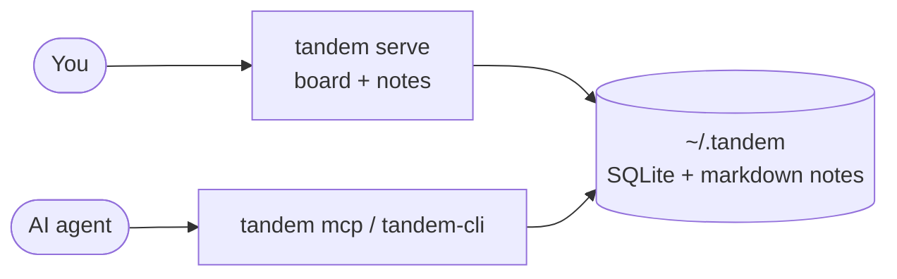

# Tandem

[](https://github.com/gianniacquisto/tandem/actions/workflows/release.yml)
[](https://github.com/gianniacquisto/tandem/releases/latest)
[](LICENSE)


**A board for you and your AI coding agents, in one binary.**

You and your agent share one ticket list: it files tickets you see, and it sees the ones you close. Tickets sit on a board by status and lane, with an inbox for what the agents owe you, plus a folder of markdown notes you both read and write. Everything is local: one SQLite database and your own files, with no account and no network.

## Install

```sh
curl -fsSL https://github.com/gianniacquisto/tandem/releases/latest/download/install.sh | sh
```

This verifies a SHA-256 checksum and installs `tandem` (and a `tandem-cli` link) into `~/.local/bin`. Add that to your PATH if the installer says it is missing. Supported: macOS on Apple silicon and Linux on x86_64. On Windows, download the [zip](https://github.com/gianniacquisto/tandem/releases/latest), extract `tandem.exe` and put it on PATH. More options, uninstall and macOS notes: [install paths](docs/install-paths.md).

## Run

```sh
tandem serve --open   # the board, in your browser
tandem mcp            # the same store, as an MCP server for your agent
tandem doctor         # check that the install and your data are healthy
```

Your data lives in `~/.tandem`.

## How it fits together



Details in [architecture](docs/architecture.md).

## Docs

- [Architecture](docs/architecture.md)
- [CLI reference](docs/cli.md)
- [Store, backup and notes](docs/store.md)
- [Glossary](GLOSSARY.md) and [ADRs](docs/adr/)
- [Contributing](CONTRIBUTING.md) and [releasing](docs/releasing.md)

## Licence

MIT. See [LICENSE](LICENSE) and [NOTICE.txt](NOTICE.txt).
