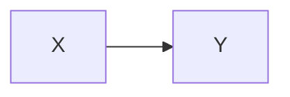

# Kitchen sink

A paragraph with [[a wikilink]], an  and a #tag.

- [ ] task one
- [x] task two

| Left | Right |
| ---- | ----- |
| a    | b     |

> A quote.
>
> - inside

$$
\int_0^1 x\,dx
$$

<aside>
raw html
</aside>

[^note]: a definition

## After the sink

---

Closing paragraph.
