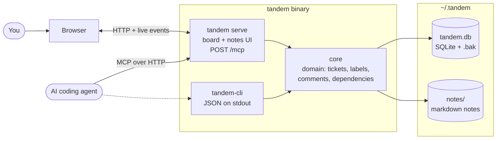

# Architecture

Tandem is one Rust binary with two doors onto one local home directory: `tandem serve`, a long-running server started by hand, and the CLI. No account, no service files.

## Pieces

- **Core** (`rust/core`): the domain (tickets, labels, comments, the blocking edge), the store adapter (all SQL lives there) and the notes store (the markdown notes). Every door calls it, so the board, the MCP tools and the CLI cannot disagree.
- **`tandem serve`**: serves the board and notes pages in your browser and the agents' MCP endpoint (`POST /mcp`), and watches the home, so a change made by an agent appears live. One process for every session ([ADR 0047](adr/0047-serve-is-the-single-door.md)).
- **`tandem-cli`**: the same binary under a second name, printing JSON, for scripts and humans; with `TANDEM_SERVER` set it talks to a running serve. See the [CLI reference](cli.md).
- **The home** (`~/.tandem`): `tandem.db` is the store, with one rolling backup beside it, and `notes/` is plain markdown you can edit by hand. See [the store](store.md).

## Decisions

The reasoning behind each piece is in the [ADRs](adr/README.md), indexed by which are still in force, starting with [one database](adr/0031-one-database-the-store.md) and the [board and notes cut](adr/0045-the-board-and-notes-cut.md).
