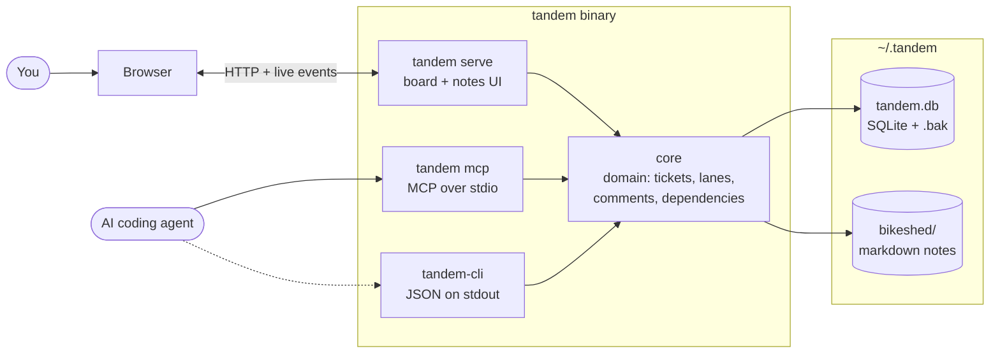

# Architecture

Tandem is one Rust binary with three doors onto one local home directory. Nothing else runs: no daemon, no network service, no account.

## Pieces

- **Core** (`rust/core`): the domain (tickets, lanes, comments, the blocking edge), the store adapter (all SQL lives there) and the bikeshed (the notes vault). Every door calls it, so the board, the MCP tools and the CLI cannot disagree.
- **`tandem serve`**: serves the board and notes pages in your browser and watches the home, so a change made by an agent appears live.
- **`tandem mcp`**: the agent face over MCP on stdio, the same operations the CLI offers.
- **`tandem-cli`**: the same binary under a second name, printing JSON, for scripts and humans. See the [CLI reference](cli.md).
- **The home** (`~/.tandem`): `tandem.db` is the store, with one rolling backup beside it, and `bikeshed/` is plain markdown you can edit by hand. See [the store](store.md).

## Decisions

The reasoning behind each piece is in the [ADRs](adr/), starting with [one database](adr/0031-one-database-the-store.md) and the [board and notes cut](adr/0045-the-board-and-notes-cut.md).
